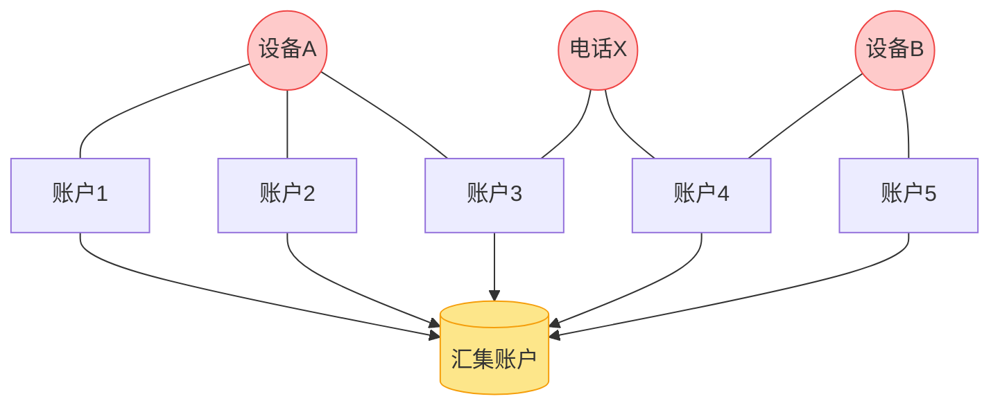

# 3 图计算与反欺诈

有些风险，单看一个人是看不出来的

---

# 为什么要看“关系”？

<div class="grid grid-cols-2 gap-6">

<div>

**一个典型欺诈团伙**

- 10 个账户，各自看起来都正常
- 但它们<b>共用 3 个设备、2 个联系人、1 个 Wi-Fi</b>
- 借款后资金快速汇入同一个账户

单个客户的特征：**没问题**<br/>
把它们连成图：**一眼就能看出来**

<v-click>

**其他关系型风险**

- 多头借贷
- 担保圈、互保链
- 集团客户与隐性实控人
- 空壳公司资金闭环

</v-click>

</div>

<div>



</div>

</div>

---

# 图计算的基本工具箱

| 概念 | 含义 | 风控里的用途 |
|---|---|---|
| 节点 / 边 | 实体（人、设备、账户） / 关系（共用、转账、担保） | 构建关系网络 |
| 度、度中心性 | 一个节点连接了多少边 | 一台设备关联很多账户 → 可疑 |
| 连通分量 / 社区发现 | 找出紧密连接的群体 | 识别欺诈团伙 |
| 一度 / 二度关联特征 | 邻居中有多少是坏客户 | 给个体加上“朋友圈风险” |
| 路径与环 | 资金是否绕了一圈回来 | 资金闭环、循环担保 |

```python
import networkx as nx
G = nx.Graph()
G.add_edges_from([("设备A", "账户1"), ("设备A", "账户2"), ("设备A", "账户3")])
for comp in nx.connected_components(G):
    if len(comp) >= 3:
        print("可疑团伙:", comp)
```

---

# 异常检测：没有“坏样本”时怎么办？

<div class="grid grid-cols-2 gap-6">

<div>

**欺诈样本极少、而且手法天天变**<br/>
→ 监督学习学不到新套路

**无监督/半监督思路**

- **孤立森林**：异常点更容易被“孤立”出来
- **自编码器**：重构误差大 = 不像正常行为
- **规则 + 阈值**：同一设备 1 小时内申请超过 5 次

</div>

<div>

```python
from sklearn.ensemble import IsolationForest

iso = IsolationForest(
    contamination=0.01, random_state=42
)
iso.fit(X_normal)
score = -iso.score_samples(X_new)   # 越大越异常
```

<div class="mt-3 p-3 bg-yellow-50 rounded text-sm">
异常 ≠ 欺诈。异常检测只是<b>线索</b>，最后仍需结合业务规则和人工核实。
</div>

</div>

</div>

---

# 案例：重庆银行用图计算做“穿透”

<div class="text-sm opacity-70">来源：金科创新社 · 鑫智奖 2026《重庆银行：AI 智能体驱动的“重银晓警”风险智能预警平台》</div>

<div class="mt-4">

**要识别的高隐蔽风险**：隐蔽性关联交易、多头授信、过度融资、空壳运作

</div>

<div class="grid grid-cols-3 gap-3 mt-4 text-center">

<div class="p-3 bg-blue-50 rounded"><b>图计算</b><br/><span class="text-sm">构建客户关联网络，穿透集团客户、隐性实控人、资金闭环路径</span></div>

<div class="p-3 bg-green-50 rounded"><b>异常检测模型</b><br/><span class="text-sm">实时捕捉高频异常交易、虚假背景、违规资金挪用</span></div>

<div class="p-3 bg-orange-50 rounded"><b>智能体</b><br/><span class="text-sm">自动汇总线索、触发预警、跟进处置、复盘</span></div>

</div>

<div class="mt-6 p-3 bg-gray-50 rounded">
目标：风险管理从“<b>事后补救</b>”走向“<b>事中干预、事前感知</b>”。
</div>

<!--
【53:00】这是从图计算过渡到智能体的桥：图和异常检测提供“线索”，智能体负责把线索变成行动。下一部分会完整拆解这个案例。
-->
