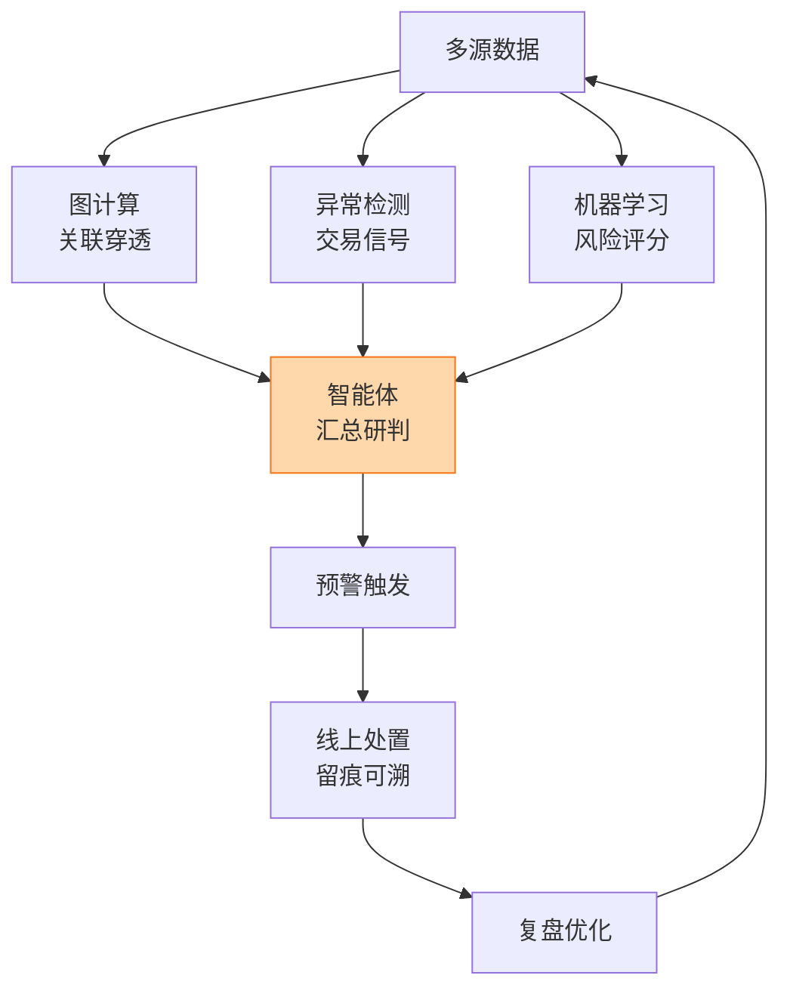
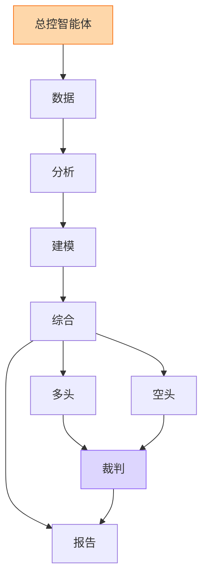
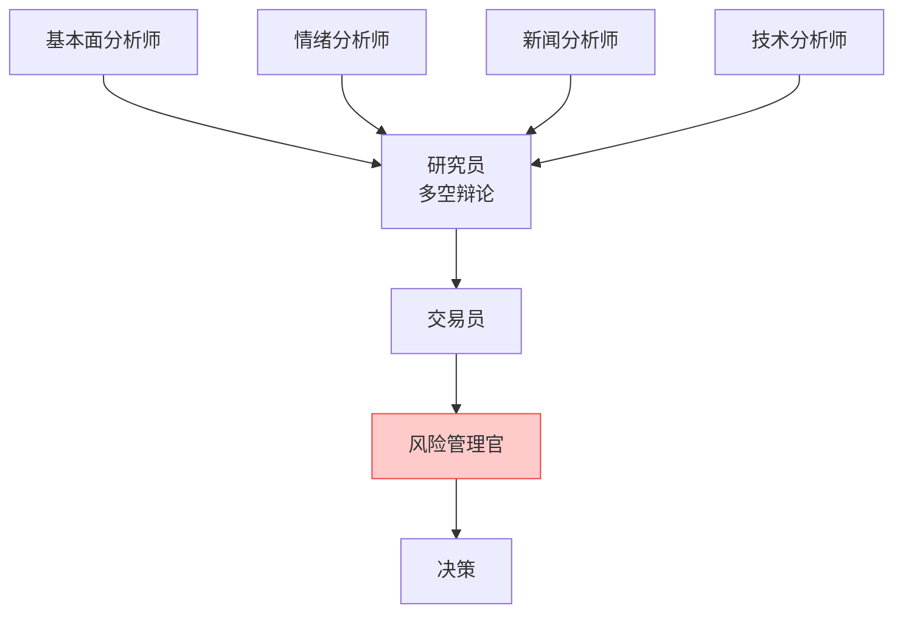

# 4 金融智能体

从“会说话的模型”到“会办事的数字员工”

---

# 大模型 ≠ 智能体

<div class="grid grid-cols-2 gap-6 mt-6">

<div class="p-4 rounded border-2 border-gray-300">

### 大模型（LLM）

- 你问一句，它答一句
- 只能依靠训练时的知识
- 擅长：理解、总结、生成
- 不会自己去查数据、调系统
- 数字可能“一本正经地编”

</div>

<div class="p-4 rounded border-2 border-orange-400 bg-orange-50">

### 智能体（Agent）

- 接受<b>目标</b>，自己<b>拆解任务</b>
- 能<b>调用工具</b>：查库、算指标、检索、写报告
- 有<b>记忆</b>，能多步迭代
- 有<b>护栏</b>：权限、审核、留痕
- “能办事的 AI”

</div>

</div>

<div class="mt-6 text-center text-lg">
智能体 = 大模型（大脑）+ 工具（手脚）+ 记忆 + 规划 + 护栏
</div>

<!--
【55:00】这是全场最关键的概念页。可举例：问大模型“这家企业风险高吗”，它只能泛泛而谈；智能体会去查工商、司法、财报，计算指标，再给结论并附出处。
-->

---

# 智能体怎么工作：一个循环


<div class="grid grid-cols-4 gap-2 mt-2 text-sm">
<div class="p-2 bg-gray-50 rounded"><b>工具</b>：征信查询、工商/司法接口、财务指标计算、评分模型、知识库检索</div>
<div class="p-2 bg-gray-50 rounded"><b>记忆</b>：客户历史、任务进度、已查证据</div>
<div class="p-2 bg-gray-50 rounded"><b>规划</b>：把大任务拆成可执行步骤</div>
<div class="p-2 bg-gray-50 rounded"><b>护栏</b>：权限最小化、关键步骤人工确认</div>
</div>

---

# 金融智能体的特殊要求

<div class="grid grid-cols-2 gap-6 mt-4">

<div>

| 通用智能体 | 金融智能体 |
|---|---|
| 答得“像”就行 | **数字必须准** |
| 过程不重要 | **过程可追溯**（留痕、可审计） |
| 权限宽松 | **权限最小化**（读写分离） |
| 出错可重来 | **出错要问责** |

</div>

<div>

**一条重要的设计原则**

<div class="p-3 bg-yellow-50 rounded">

> 模型负责推理，软件负责计算，智能体负责编排，系统负责校验。

<div class="text-sm opacity-70 mt-2">— 摘自 FinRobot 项目的设计理念</div>

</div>

<div class="mt-4 text-sm">
所以：<b>利润率、估值、PD 这些数字，应由确定性代码算出来</b>；大模型只负责解释、归纳和写报告，而不是“心算”。
</div>

</div>

</div>

---

# 全景：2026 年银行智能体“批量上岗”

<div class="text-sm opacity-70">来源：央视网/中国金融信息网《上市银行半年报里的“AI竞赛”》，2026-09-03</div>

<div class="grid grid-cols-3 gap-4 mt-6 text-center">

<div class="p-4 bg-blue-50 rounded">
<div class="text-4xl font-bold text-blue-700">140</div>
平安银行上半年上线<br/>运营审核类智能体<br/>
<span class="text-xs opacity-70">覆盖 55 个业务场景：反洗钱尽调、账户审核、跨境汇款</span>
</div>

<div class="p-4 bg-green-50 rounded">
<div class="text-4xl font-bold text-green-700">156</div>
南京银行累计建成<br/>AI 智能体<br/>
<span class="text-xs opacity-70">新增 30 个；覆盖营销、运营、风控、办公</span>
</div>

<div class="p-4 bg-orange-50 rounded">
<div class="text-4xl font-bold text-orange-700">80+</div>
微众银行“数字员工”<br/>7×24 小时在线<br/>
<span class="text-xs opacity-70">研发数字员工把安全工单上线从两周缩到 30 分钟</span>
</div>

</div>

<div class="mt-6 p-3 bg-gray-50 rounded text-sm">
行业判断：2025 年是银行大模型部署元年，2026 年上半年智能体成为落地核心载体；但整体仍处于“<b>场景验证向规模化复制</b>”的过渡阶段。
</div>

---

# 案例一：重庆银行“重银晓警”风险智能预警平台

<div class="text-sm opacity-70">来源：金科创新社 · 鑫智奖 2026</div>

<div class="grid grid-cols-2 gap-6 mt-2">

<div>

**痛点**

- 数据孤岛、响应滞后、缺少闭环
- 预警集中在贷后，发现太晚

**做法**

- “AI 大模型分析 + 大小模型协同执行”的智能体框架
- 打通：风险特征挖掘 → 预警策略迭代 → 预警触发 → 处置跟进 → 全景展示 → 复盘
- 融合传统机器学习 + 图计算 + 异常检测
- 前中后台联动、处置过程留痕可溯

</div>

<div>



</div>

</div>

<div class="p-2 bg-blue-50 rounded text-sm">
<b>启示</b>：智能体不是取代前面学过的评分卡/图/异常检测，而是把它们<b>组织起来、闭环起来</b>。
</div>

---

# 案例二：信贷尽调与审核类智能体

<div class="text-sm opacity-70">来源：中国新闻网上海站《金融智能体迈入规模化落地周期》，2026-07-29；央视网同文</div>

<div class="grid grid-cols-3 gap-4 mt-6">

<div class="p-3 border rounded">
<b>🏦 华兴银行</b><br/>
<span class="text-sm">借助腾讯云信贷尽调助手，授信调研周期压缩到约 <b>1 小时</b>，整体业务效率提升约十倍</span>
</div>

<div class="p-3 border rounded">
<b>🏦 工商银行</b><br/>
<span class="text-sm">基于多模态能力打造商户智能审核助手，替代传统图文核验</span>
</div>

<div class="p-3 border rounded">
<b>🏦 平安银行</b><br/>
<span class="text-sm">运营审核类智能体用于反洗钱尽调、账户审核、跨境汇款</span>
</div>

</div>

<div class="mt-6">

**共同特点**

- 任务**重复、文档多、规则明确** → 最适合先上智能体
- 智能体做“初审 + 整理证据”，人做“最终判断”
- 效率提升显著，但不是“无人化”

</div>

---

# 案例三：开源多智能体 FinRobot

<div class="text-sm opacity-70">来源：GitHub · AI4Finance-Foundation/FinRobot（论文 arXiv:2405.14767）</div>

<div class="grid grid-cols-2 gap-6 mt-2">

<div>

**四层架构**

1. 金融 AI 智能体层（金融思维链 CoT）
2. 大模型算法层
3. 基础设施/运维层
4. 基础模型层（可插拔）

**智能体工作流：感知 → 大脑 → 行动**

- 感知：行情、新闻、财报等多模态数据
- 大脑：大模型 + 金融思维链生成结构化指令
- 行动：调用工具、生成报告、发出预警

</div>

<div>

**最新版本的多智能体流水线**



<div class="text-xs mt-1 opacity-80">
“多空辩论”：让正反两方智能体互相挑错，降低单一观点的偏差。
</div>

</div>

</div>

<div class="p-2 bg-yellow-50 rounded text-sm">
关键设计：<b>财务数字由确定性代码计算</b>，大模型只负责叙述；每个输出都带来源，可追溯。
</div>

---

# 案例四：TradingAgents——像一家投研公司那样协作

<div class="text-sm opacity-70">来源：GitHub · TauricResearch/TradingAgents（研究与教学框架）</div>

<div class="grid grid-cols-2 gap-6 mt-4">

<div>



</div>

<div>

**值得学生注意的三点**

1. **角色分工**：不同智能体专注不同视角，像真实团队
2. **风控官是独立角色**：先有人“踩刹车”，再执行
3. **定位是研究与模拟**：项目明确主要用于学习、研究，不构成投资建议

<div class="mt-3 p-2 bg-red-50 rounded text-sm">
⚠️ 回测漂亮 ≠ 实盘赚钱。把它当作理解“多智能体协作”的教材，而不是赚钱工具。
</div>

</div>

</div>

---

# 动手看：一个极简的“贷前尽调风控智能体”

```python {all|1-14|16-30|32-45}
from dataclasses import dataclass

# ---- 1) 工具：确定性函数，数字由代码算，不让模型心算 ----
def get_financials(company):          # 真实场景：对接财报库
    return {"debt_ratio": 0.78, "current_ratio": 0.9, "net_margin": -0.02}

def get_legal_risk(company):          # 真实场景：对接司法/工商接口
    return {"lawsuits_12m": 5, "dishonest_executor": False}

def score_pd(fin, legal):             # 真实场景：调用已上线的评分模型
    pd_ = 0.02 + 0.08*(fin["debt_ratio"] > 0.7) + 0.03*(legal["lawsuits_12m"] > 3)
    return round(pd_, 3)

TOOLS = {"财务": get_financials, "司法": get_legal_risk}

# ---- 2) 智能体：规划 -> 调用工具 -> 汇总 -> 交人工 ----
@dataclass
class Report:
    company: str
    pd_est: float
    evidence: list
    suggestion: str
    need_human: bool

def due_diligence(company, llm):
    plan = llm.plan(f"评估 {company} 的授信风险", tools=list(TOOLS))   # 大模型规划
    evidence = {}
    for step in plan:                                               # 逐步执行
        if step in TOOLS:
            evidence[step] = TOOLS[step](company)
            log(company, step, evidence[step])                      # 全程留痕
    pd_est = score_pd(evidence["财务"], evidence["司法"])          # 代码计算
    text = llm.write(f"依据证据写风险摘要，不得编造数字：{evidence}, PD={pd_est}")
    need_human = pd_est > 0.05                                     # 高风险必须人工
    return Report(company, pd_est, evidence, text, need_human)
```

<!--
【65:00】逐段讲：①工具是确定性的；②大模型只做规划与写作；③高风险强制转人工；④全程留痕。llm 对象和 log 函数在课件里是示意，不要求现场运行。
-->

---

# 这个小例子里藏着的 5 个设计要点

<div class="grid grid-cols-2 gap-4 mt-6">

<div class="p-3 bg-blue-50 rounded"><b>① 工具化</b><br/>财务、司法、评分都是函数，边界清晰，可单测</div>

<div class="p-3 bg-green-50 rounded"><b>② 计算与叙述分离</b><br/>PD 由代码算；大模型只写文字，且被要求“不得编造数字”</div>

<div class="p-3 bg-yellow-50 rounded"><b>③ 留痕</b><br/>每一步调用都写日志，事后可审计、可复现</div>

<div class="p-3 bg-orange-50 rounded"><b>④ 人在回路</b><br/>PD 超阈值或证据不足，自动转人工，不自作主张</div>

<div class="p-3 bg-purple-50 rounded col-span-2"><b>⑤ 权限最小化</b><br/>这个智能体只有“读”的工具，没有“放款/改额度”的工具——危险动作根本不给它</div>

</div>

---

# 现实边界：智能体能做什么，不能做什么

<div class="text-sm opacity-70">来源：央视网/中国金融信息网（2026-09-03）</div>

<div class="grid grid-cols-2 gap-6 mt-4">

<div class="p-4 border-2 border-green-300 bg-green-50 rounded">

### ✅ 已大量落地（低至中风险）

- 内部助手、知识问答
- 客服辅助
- 信贷材料处理、尽调整理
- 运营审核初审
- 研发与测试提效

</div>

<div class="p-4 border-2 border-red-300 bg-red-50 rounded">

### ⛔ 仍由人工最终把关

- 授信审批
- 大额放款
- 核心金融交易的自主执行
- 对客户权益有重大影响的决定

</div>

</div>

<div class="mt-6 text-center text-lg">
下一步的突破口：从“能对话”走向 <b>“可控、可用、可问责”</b>
<div class="text-sm opacity-70 mt-1">可信数据底座 · 权限与审计机制 · 人机协同闭环 · 评测体系</div>
</div>

---

# 小组讨论（3 分钟）

<div class="text-xl mt-6">

四人一组，设计一个**风控智能体**：

</div>

<div class="grid grid-cols-2 gap-4 mt-6 text-lg">

<div class="p-3 bg-blue-50 rounded">
1. 它要解决什么<b>具体任务</b>？<br/>
<span class="text-sm opacity-70">例：核查网贷申请中的收入证明是否造假</span>
</div>

<div class="p-3 bg-green-50 rounded">
2. 它能用哪些<b>工具</b>？
</div>

<div class="p-3 bg-red-50 rounded">
3. 它<b>绝对不能碰</b>什么权限？
</div>

<div class="p-3 bg-orange-50 rounded">
4. 什么情况下必须<b>转人工</b>？
</div>

</div>

<!--
【76:00】3 分钟讨论 + 抽 2 组分享（约 1 分钟）。引导：好的设计往往“给的工具少而精”。
-->
